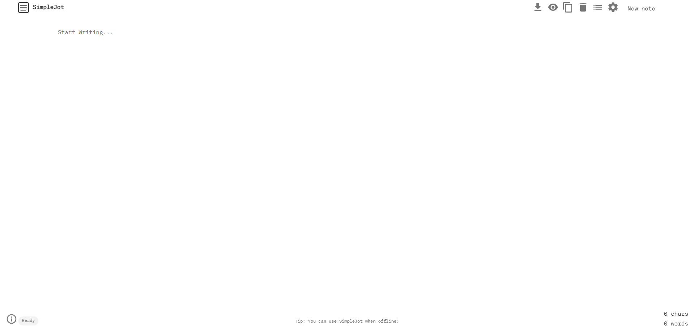

# TextCove

### Formely known as [SimpleJot](https://github.com/2nul/simplejot)

[](https://jot.2nul.dpdns.org/)
[](package.json)
[](tests/)
[](LICENSE)

A fast, private, offline-ready notepad. No accounts, no tracking, no WYSIWYG clutter. Your notes live in your browser (IndexedDB + localStorage recovery) until you decide to delete or download them.

**Website:** https://tc.2nul.dpdns.org/ or https://textcove.pages.dev



## Features

- Instant autosave with a visible status (`Saving...` / `Saved • 12:03` / error states)
- Multiple notes with search (title + content), sort (last edited / A-Z), pins, snippets and edit dates
- Delete with click-to-undo (status bar) instead of instant permanent loss
- Markdown preview: headings, **bold**, *italic*, `code`, fenced code blocks, checklists, quotes
- One-click `.txt` download, full JSON export, JSON file import, drag-and-drop import
- Copy-to-clipboard and print stylesheet
- Keyboard shortcuts: `Ctrl+S` save, `Ctrl+N` new note, `Ctrl+K` search, `Tab` indent
- Offline-first PWA: installable, custom icons, app shortcuts
- Online, the page checks for a newer service worker on load and on reconnect, then swaps to it automatically; offline, the newest cached copy is served
- Theming: manual light/dark toggle (defaults to light), deep-slate dark mode
- Accessible: labelled controls, native `<dialog>`, live-region save status, `prefers-reduced-motion`

## Keyboard shortcuts

| Keys | Action |
| --- | --- |
| `Ctrl`/`Cmd` + `S` | Download current note as `.txt` |
| `Ctrl`/`Cmd` + `N` | New note |
| `Ctrl`/`Cmd` + `K` | Search notes |
| `Tab` (in editor) | Indent two spaces |

## Technology stack

- HTML5, CSS3, vanilla JavaScript — zero runtime dependencies
- IndexedDB for notes, localStorage for settings and crash recovery
- Native `<dialog>`, native `a[download]` + Blob URLs, hand-written word counter
- IBM Plex Mono for readability

## File structure

```
textcove/
├── index.html          # App shell, SEO tags, native dialog
├── 404.html            # Not-found page
├── app.css             # Styling, responsive, print, reduced-motion
├── app.js              # Application logic, no dependencies
├── boot.js             # Service-worker registration, theme, dev reload
├── sw.js               # Service worker (cache name stamped by npm run build)
├── manifest.webmanifest# PWA manifest with icons and app shortcuts
├── assets/             # Icons, screenshots, webfont
├── serve-local.mjs     # Dev server with live reload (older variant)
├── robots.txt
├── sitemap.xml
├── package.json        # build / test / check scripts
├── scripts/build.mjs   # Stamps a content hash into sw.js
├── scripts/serve-local.mjs # Dev server used by npm run dev
└── tests/              # node:test suites (no extra dependencies)
```

## Development

```bash
npm run dev     # serve locally at http://localhost:8080 (required: service workers and PWA install do not work over file://)
npm run build   # stamp a content hash into the service-worker cache name
npm test        # run the test suites
npm run check   # syntax-check the JavaScript
```

## Credits

Based on the original [TextPad](https://github.com/syndicatefx/TextPad) project by Paulo Nunes.
The previously vendored FileSaver.js, Smoke.js and Countable.js helpers were replaced with small native implementations.

## License

[TextCove Non-Commercial Attribution License](https://github.com/2nul/TextCove/blob/main/LICENSE)
